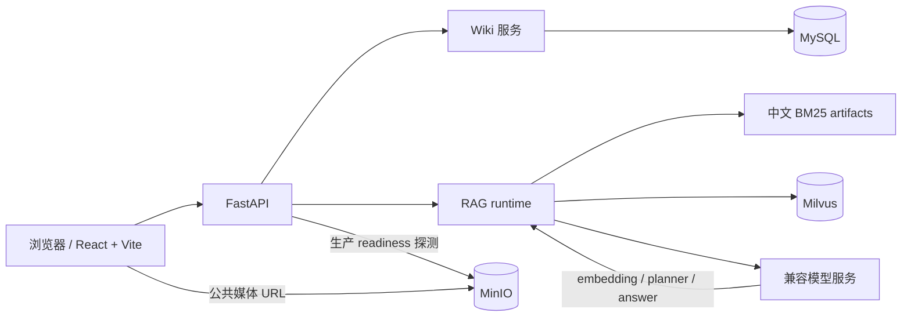
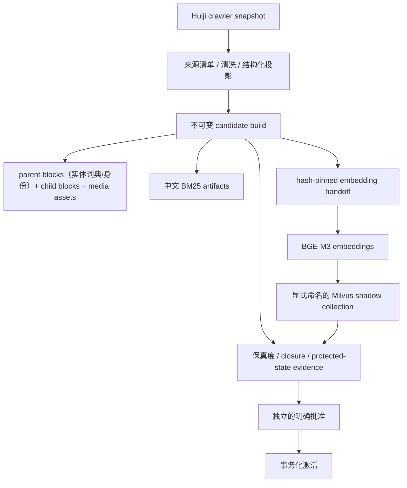
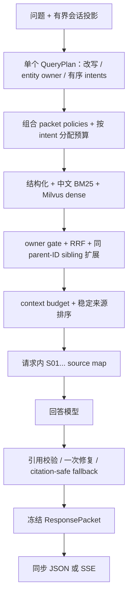

[English](README_EN.md)

# 1999Search

面向《重返未来：1999》的本地知识库、Wiki 与可追溯 RAG 问答系统。

> 正式语料仅来自 Huiji crawler（`huiji.source_mode=huiji_crawler`）。运行时配置的 collection 名称必须与活动 build 一致：generation-zero/legacy 身份由已安装的 provenance baseline 提供，而 generation `> 0` 则由活动指针及其事务所属的 activation evidence 验证；退休语料链路不是回滚路径。

## 能力与导航

- **可追溯问答：** 请求内稳定分配 `S01...` 来源标识，并在生成后校验引用。
- **受限检索：** planner、实体 owner 门禁、结构化/BM25/向量混合检索与分层扩展共同约束上下文。
- **可运维运行时：** provenance 门禁、shadow collection 和健康检查将不可信数据与问答服务隔离。

[快速开始](#快速开始) · [RAG 设计](#rag-设计与信任边界) · [二次开发](#二次开发地图) · [排障](#故障排查)

## 项目概览

1999Search 提供 React/Vite Wiki 前端和 FastAPI API：同步问答、SSE 问答、有界的进程内会话记忆、Wiki 浏览以及媒体/语音分页。下图聚焦运行时与信任边界；仓库跟踪的前端媒体是应用资产，不是 RAG 回答链路的证据。

## 系统架构



## 技术与组件职责

| 组件 | 职责 | 默认实现/入口 |
|---|---|---|
| Web | Wiki、问答、媒体与会话交互 | React + Vite，`frontend/react-app/` |
| API | 同步问答、SSE、Wiki、媒体、健康检查 | FastAPI，`backend/main.py` |
| RAG runtime | 规划、检索、生成、引用、记忆与响应冻结 | `src/rag/` |
| Corpus build | 将 crawler snapshot 投影为语料与检索产物 | `src/huiji_rag/` |
| 稠密检索 | child block 向量检索 | Milvus + `BAAI/bge-m3` |
| 稀疏检索 | 中文关键词候选 | 本地中文 BM25 artifacts |
| Wiki 存储 | Wiki 结构化页面 | MySQL |
| 资产存储 | 图片、视频、语音对象 | MinIO |
| 模型服务 | embedding、planner、回答生成 | 配置驱动的 OpenAI-compatible APIs（默认模型配置含 `deepseek-v4-flash`） |

## 离线语料与索引流程



Candidate 输出和 shadow evidence 都使用 create-new 语义。shadow 索引命令只接受显式命名、非活动且尚不存在的 collection；它不会激活、覆盖或删除 collection。parent block 供实体词典和身份使用；其正文不会注入回答上下文。回答上下文使用 child 检索，并只在相同 `parent_id` 内扩展相邻 child（sibling）；媒体资产保留 owner/source 绑定。[Huiji RAG runbook](docs/huiji-rag-runbook.md) 说明更广泛的活动语料 provenance 与运维恢复生命周期。其 shadow build 示例早于当前必需的 handoff flags；当前 build invocation 应以本文下方[数据与索引维护](#数据与索引维护)中的完整命令为准。不可变 candidate、评审和独立授权的激活实现位于 `src/huiji_rag/build/`、`scripts/build_huiji_corpus.py` 与 `scripts/activate_huiji_candidate.py`。

## 在线可信 RAG 流程



## RAG 设计与信任边界

- **运行时 fail-closed：** runtime 不会重建 artifacts、重建或激活索引、覆盖 collection，亦不会修复不匹配。artifacts、BM25、collection 或 provenance 不一致时，健康检查仍可用，而 RAG `/ask` 与 `/ask/stream` 返回 `503`。
- **证据与记忆分离：** 最多六轮近期对话会被投影，用于追问改写和回答连贯性。历史 assistant 引用会被显式标记为失效，历史也被标记为非证据；事实证据只来自本轮检索，并在最终来源排序后分配 `S01...`。
- **单个多意图计划：** 每个请求只产生一个 `QueryPlan`，其中包含主 `intent` 和有序去重的 `secondary_intents`。下游为这组意图组合 packet policy 与覆盖目标；不会为每个意图创建独立的公开子请求或响应包。
- **检索边界：** 结构化精确行与中文 BM25、Milvus dense 候选共同参与检索，后两路经 weighted RRF 融合。owner 过滤贯穿检索、可选 rerank、扩展和最终分配；parent block 只提供实体词典/身份，回答上下文只将已检索的 child block 扩展到相同 `parent_id` 的相邻 child（sibling）。按意图/上下文预算在维持覆盖的同时阻止其他实体的数据进入。
- **回答边界：** 此基线的公开 `grounding_mode` 只有 `grounded`、`ungrounded` 和 `none`。`grounded` 使用本轮证据并执行引用校验；`ungrounded` 是明确授权的非证据回答路径，且会移除类似来源引用的 token；`none` 用于服务缺失、检索为空或失败等不可提交结果。这里没有公开 `mixed` 模式。引用校验会规范化安全格式、最多尝试一次修复，否则替换为 citation-safe fallback。
- **SSE 语义：** 服务只执行一次检索与回答生成，完成引用校验并冻结 `ResponsePacket` 后才派生传输事件。完整流依次发送 `sources`、零个或多个来自已验证答案的 32 字符 `token` chunk、`done`；`done` 与同步 JSON 序列化同一个 packet。此基线没有 `answer_replace` 事件。`sources` 携带较早的 timing snapshot，`done` 携带最终版本；对四个标记均有值的生成式回答，顺序为 `model_first_token_ms <= validated_ready_ms <= visible_first_token_ms <= completed_ms`。执行失败只发 `error` 而不发 `done`，在最终化前断开也不会提交会话轮次。
- **可选 reranker：** `reranker.enabled` 默认是 `false`，配置模型为 `BAAI/bge-reranker-v2-m3`；启用前应验证服务、预算和来源映射契约。

## 前置条件

- Windows 本地开发：Python、Node.js/npm、Docker Desktop 与 Docker Compose。
- 可用的 embedding 与回答模型服务凭据；凭据仅放在本地 `.env` 或受保护的运行时环境文件，不提交到仓库。
- 已准备的 Huiji processed artifacts，以及 Milvus、MinIO、MySQL。

## 快速开始

按“前置条件 → 配置 → 启动 → 验证”执行。以下命令只说明本地启动方式；不要把它们用于未经审计的索引激活或生产发布。

1. 从示例创建本地 `.env`（已有 `.env` 时不要覆盖）：

   ```powershell
   Copy-Item .env.example .env
   ```

   打开 `.env`，替换 API、MinIO 和 MySQL 的凭据占位符；若运行时需要外部 artifacts，设置绝对路径 `HUIJI_PROCESSED_ROOT`。本地 `infra\milvus\docker-compose.yml` 将 MySQL 映射到宿主机 `3307`，所以本地 `.env` 必须使用 `MYSQL_PORT=3307`（`.env.example` 已给出该值），不能沿用 `config/settings.yaml` 的容器内默认 `3306`。其 MinIO 服务将 root user 和 password 都硬编码为公开开发默认值 `minioadmin`，因此除非修改该 Compose 文件，本地 `MINIO_ACCESS_KEY` 和 `MINIO_SECRET_KEY` 都必须为 `minioadmin`；这是 Compose 的开发默认值，不是生产密钥。保留 `config/settings.yaml` 中的 `huiji.enabled: true` 与 `huiji.source_mode: huiji_crawler`。
2. 手动启动基础设施和应用。仓库中的 `start.bat` 只会转交给 `start.ps1`；该 PowerShell 启动器在此基线上已经过时：它硬编码一条机器特定的 Python 绝对路径，并仍尝试启动已删除的 `frontend\streamlit_app.py` 与 `frontend\gradio_app.py`。不要把这两个启动器当作可移植的快速启动方式。

   ```powershell
   python -m pip install -r requirements.txt
   python scripts\check_runtime_dependencies.py --requirements requirements\dev.lock.txt
   docker compose -f infra\milvus\docker-compose.yml up -d --wait
   python scripts\verify_huiji_runtime.py
   python -m uvicorn backend.main:app --host 127.0.0.1 --port 8000
   ```

3. 验证：访问 `http://127.0.0.1:8000/health`，并确认 `status` 为 `ok`、`provenance_status` 为 `pass`。下方 React 开发服务器使用 `http://127.0.0.1:5173`。

另开终端启动前端：

```powershell
cd frontend\react-app
npm install
npm run dev -- --host 127.0.0.1 --port 5173 --strictPort
```

## 配置

本文启动命令使用 FastAPI `127.0.0.1:8000` 与 Vite `127.0.0.1:5173`。`config/settings.yaml` 的本地服务地址是 Milvus `127.0.0.1:19600`、MinIO S3 `127.0.0.1:9002` 与 MySQL `3306`；本地 Compose 另将 MinIO Console 暴露到 `127.0.0.1:9003`，并将 MySQL 暴露到宿主机 `3307`（容器内 `3306`）。因此复制得到的本地 `.env` 会用 `MYSQL_PORT=3307` 覆盖设置。运行时身份仅在 generation-zero/legacy 验证中来自已安装的 provenance baseline；generation `> 0` 时，配置必须与活动指针及其事务所属的 activation evidence 一致。

生产 Compose 使用服务间地址，而不是上述宿主机端口：Milvus `standalone:19530`、MinIO `minio:9000`、MySQL `mysql:3306`，示例见 [app.env.example](deploy/env/app.env.example) 与 [compose.app.yml](deploy/compose.app.yml)。该示例刻意不可直接运行，须复制到 Git 外的受保护文件并填入凭据。

常用键/环境变量：

| 用途 | 配置或环境变量 |
|---|---|
| 向量库与活动 collection | `vectorstore.*`、`MILVUS_URI`、`MILVUS_DB_NAME`、`MILVUS_COLLECTION_NAME` |
| 运行时身份与授权依据 | `vectorstore.collection_name` + `huiji.text_collection_name`；generation-zero/legacy：`huiji.provenance_baseline`；generation `> 0`：活动指针 + 事务所属的 activation evidence |
| 模型凭据 | `DEEPSEEK_API_KEY`、`SILICONFLOW_API_KEY` |
| 资产 | `MINIO_ENDPOINT`、`MINIO_ACCESS_KEY`、`MINIO_SECRET_KEY`、`MINIO_BUCKET` |
| Wiki 数据库 | `MYSQL_HOST`、`MYSQL_PORT`、`MYSQL_DATABASE`、`MYSQL_USER`、`MYSQL_PASSWORD` |
| 运行时 artifacts | `HUIJI_PROCESSED_ROOT` |

## 服务端点与 API 示例

| 端点 | 方法 | 用途 |
|---|---|---|
| `/health/live` | GET | 进程存活检查 |
| `/health/ready` | GET | 仅在 `APP_ENV=production` 下对配置、artifacts、Milvus、MinIO、MySQL 做完整子系统就绪检查；非生产环境中 `ready` 响应不证明这些依赖可达 |
| `/health` | GET | RAG 加载和 provenance 状态 |
| `/ask` | POST | 同步问答 |
| `/ask/stream` | POST | `text/event-stream` 问答事件 |
| `/conversations/{conversation_id}` | DELETE | 清除会话，成功返回 `204` |
| `/api/media/voice/page` | GET | 基于 `cursor` 的语音分页 |
| `/api/wiki/*` | GET | Wiki categories、pages、route resolve、search 与 health |

同步请求对应 `AskRequest`；下面的响应摘录只使用 `AskResponse`/`SourceItem` 中存在的字段：

```powershell
$body = @{
  question = '介绍苏芙比的技能'
  category = '人物'
  route_options = @{ expanded = $false; free_supplement = $false }
} | ConvertTo-Json -Depth 4

Invoke-RestMethod -Method Post -Uri http://127.0.0.1:8000/ask `
  -ContentType 'application/json' -Body $body
```

```json
{
  "answer": "……[S01]",
  "grounding_mode": "grounded",
  "sources": [{
    "citation_id": "S01",
    "name": "苏芙比",
    "category": "人物",
    "source": "…",
    "score": 0.0
  }],
  "memory": { "status": "disabled", "turns_used": 0, "rewrite_mode": "none" }
}
```

## 数据与索引维护

改变活动语料状态前先阅读 [Huiji RAG runbook](docs/huiji-rag-runbook.md)，以了解更广泛的生命周期背景。其 shadow build 命令早于当前必需的 handoff flags；当前 build invocation 应以下方完整命令为准。仅对已审阅、处于 `ready_for_embedding` 状态的 candidate build 执行 shadow 构建：使用该 build 的 `handoff/embedding_handoff.v1.json`，先计算并人工核对 SHA-256，再将同一摘要传给 CLI。此基线中 `--collection-name`、`--handoff-manifest` 与 `--expected-handoff-sha256` 为必需参数；`--run-dir` 可选，但下例显式提供它，以便将 evidence 保存在已知的 create-new 目录。以下命令只创建新的 shadow collection；不会激活、覆盖或删除 collection：

```powershell
$RunId = (Get-Date).ToUniversalTime().ToString('yyyyMMddTHHmmssZ') + '-huiji-source'
$RunDir = Join-Path 'eval\huiji_provenance' $RunId
$Shadow = 'text_child_bge_m3_shadow_' + ($RunId.ToLower() -replace '[^a-z0-9_]', '_')
$Handoff = 'data\processed\huiji\<reviewed-build-version>\handoff\embedding_handoff.v1.json'
if (-not (Test-Path -LiteralPath $Handoff -PathType Leaf)) { throw "Reviewed embedding handoff not found: $Handoff" }
$HandoffSha256 = (Get-FileHash -LiteralPath $Handoff -Algorithm SHA256).Hash.ToLowerInvariant()
# Compare $HandoffSha256 with the reviewed handoff record before continuing.
python scripts\build_huiji_index.py `
  --collection-name $Shadow `
  --handoff-manifest $Handoff `
  --expected-handoff-sha256 $HandoffSha256 `
  --run-dir "$RunDir\shadow-build"
```

运行时不做索引修复。出现 mismatch 时保持 health-only，先审计并修复原因；不要通过删除 collection、删除 artifacts 或恢复退休语料链路处理问题。

## 二次开发地图

| 想改什么 | 从哪里开始 | 必须保持的契约 |
|---|---|---|
| 模型 | `config/settings.yaml`、`src/rag/embeddings.py`、`src/rag/chain.py` | 凭据不入库；公共响应与引用边界不变 |
| planner / intents | `src/rag/query_plan.py`、`src/rag/packet_policy.py` | 安全会话投影、owner 与路由授权 |
| 混合检索 | `src/rag/retriever.py`、`src/rag/hybrid.py`、`src/rag/retrieval_budget.py` | 稳定排序、预算、owner gate、来源映射 |
| 语料投影 | `src/huiji_rag/build/` | source refs、父子关系、保真度与 provenance |
| 媒体 | `src/assets/`、`src/huiji_rag/media.py` | owner/source 绑定和安全公共 URL |
| Wiki UI | `frontend/react-app/src/components/wiki/` | API 类型、路由与移动端行为 |
| 存储 | Milvus/MySQL/MinIO 适配边界 | 健康检查、启动门禁与 fail-closed 语义 |

## 测试

聚焦 API、配置、引用与 SSE 合约：

```powershell
python -m pytest tests\test_config.py tests\test_conversation_api.py tests\test_rag_contracts.py tests\test_citations.py tests\test_sse.py -q
```

更多 RAG 执行与评估测试位于 [`tests/`](tests/)；系统理解和链路分析见 [project-understanding](docs/project-understanding/README.md) 与 [RAG QA chain analysis](docs/project-understanding/rag-qa-chain-analysis.md)。

## 故障排查

| 现象 | 首先检查 |
|---|---|
| `/health` 为 `error` 或问答返回 `503` | `python scripts\verify_huiji_runtime.py`、artifacts/BM25/provenance、Milvus 与模型凭据 |
| `/health/ready` 返回 `503` | 完整子系统检查仅在 `APP_ENV=production` 下运行：`configuration`、`rag_artifacts`、`milvus`、`minio`、`mysql`；非生产环境中 `ready` 不证明这些依赖可达 |
| 检索为空或角色串线 | `QueryPlan` 的 entity/owner 与有序 intents、structured/BM25/dense 候选、预算和分层扩展 |
| 引用被替换或回退 | `src/rag/citations.py`、来源映射和 citation validator |
| 同步与 SSE 最终结果不一致 | `ResponsePacket`、`src/rag/serializers.py` 与 SSE `done` 事件；此基线的 `token` chunk 仅在验证后发送 |
| 图片/语音串实体 | media registry 的 owner/source 绑定与公共 URL |
| 启动器失败 | 使用上方手动命令；`start.ps1` 含固定 Python 路径且引用两个已删除的前端入口 |

## 仓库结构

```text
1999Search/
├── backend/                 FastAPI、SSE、公开 schema 与 Wiki 路由
├── config/                  配置与 provenance baseline
├── data/huiji/res1999/      配置的 crawler snapshot 路径（运行时/未跟踪；干净检出中不存在）
├── data/processed/huiji/    配置的 artifact 路径（运行时/未跟踪；干净检出中不存在）
├── docs/                    架构、runbook、计划与项目理解文档
├── frontend/react-app/      React + Vite 前端
├── infra/milvus/            本地基础设施 Compose
├── scripts/                 审计、验证、评估与 shadow 构建
├── src/huiji_rag/           crawler 到 RAG artifacts 的处理链
├── src/rag/                 planner、retriever、citations、chain
└── tests/                   单元、契约与验收测试
```

## 深入文档

- [系统架构](docs/architecture.md)
- [Huiji RAG provenance 与 shadow 构建 Runbook](docs/huiji-rag-runbook.md)
- [RAG 资源与资产说明](docs/rag-assets.md)
- [Wiki/RAG 契约记录](docs/wiki-rag-contract-record.md)
- [项目理解文档索引](docs/project-understanding/README.md)

## 数据来源、非官方声明与许可证状态

本项目是非官方的粉丝/开源工程项目，不代表游戏官方。游戏名称、角色、文本与其他资产属于各自权利人；使用者应自行确认其所在地区及用途所需的权利。

当前仓库没有 `LICENSE*` 文件，复用条款尚未发布；请勿自行推定或授予许可证。
