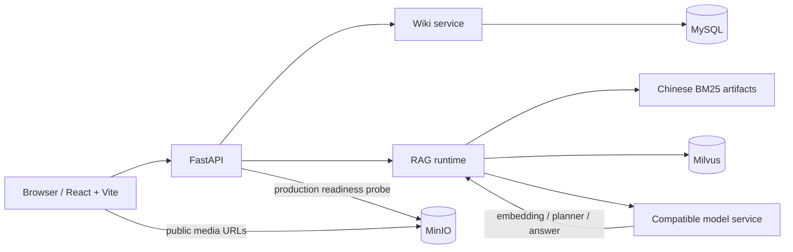
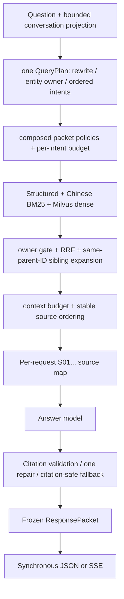

[简体中文](README.md)

# 1999Search

A local knowledge base, Wiki, and traceable RAG question-answering system for *Reverse: 1999*.

> The production corpus is sourced exclusively from the Huiji crawler (`huiji.source_mode=huiji_crawler`). At runtime, the configured collection names must agree with the active build: the installed provenance baseline supplies generation-zero/legacy identity, while generation `> 0` is verified from the active pointer and its transaction-owned activation evidence. Retired-corpus pipelines are not a rollback path.

## Capabilities and navigation

- **Traceable answers:** Stable `S01...` source identifiers are assigned within each request, and citations are validated after generation.
- **Constrained retrieval:** The planner, entity owner gate, structured/BM25/vector hybrid retrieval, and hierarchical expansion jointly constrain context.
- **Operational safeguards:** Provenance gates and shadow collections isolate untrusted data from the question-answering service, while health checks expose its state.

[Quick start](#quick-start) · [RAG design](#rag-design-and-trust-boundaries) · [Extension guide](#extension-map) · [Troubleshooting](#troubleshooting)

## Project overview

1999Search provides a React/Vite Wiki frontend and a FastAPI API: synchronous Q&A, SSE Q&A, bounded in-process conversation memory, Wiki browsing, and media/voice pagination. The diagrams below focus on the runtime and trust boundaries; tracked frontend media are application assets, not evidence used by the RAG answer path.

## System architecture



## Technologies and component responsibilities

| Component | Responsibility | Default implementation/entry point |
|---|---|---|
| Web | Wiki, Q&A, media, and conversation interactions | React + Vite, `frontend/react-app/` |
| API | Synchronous Q&A, SSE, Wiki, media, and health checks | FastAPI, `backend/main.py` |
| RAG runtime | Planning, retrieval, generation, citations, memory, and response freezing | `src/rag/` |
| Corpus build | Projects a crawler snapshot into corpus and retrieval artifacts | `src/huiji_rag/` |
| Dense retrieval | Child-block vector retrieval | Milvus + `BAAI/bge-m3` |
| Sparse retrieval | Chinese keyword candidates | Local Chinese BM25 artifacts |
| Wiki storage | Structured Wiki pages | MySQL |
| Asset storage | Image, video, and voice objects | MinIO |
| Model service | Embedding, planner, and answer generation | Configuration-driven OpenAI-compatible APIs (the default model configuration includes `deepseek-v4-flash`) |

## Offline corpus and index workflow

```mermaid
flowchart TB
    Snapshot[Huiji crawler snapshot] --> Inventory[Source inventory / cleaning / structured projection]
    Inventory --> Candidate[Immutable candidate build]
    Candidate --> Blocks[parent blocks (entity lexicon/identity) + child blocks + media assets]
    Candidate --> Sparse[Chinese BM25 artifacts]
    Candidate --> Handoff[Hash-pinned embedding handoff]
    Handoff --> Dense[BGE-M3 embeddings]
    Dense --> Shadow[Explicitly named Milvus shadow collection]
    Candidate --> Review[Fidelity / closure / protected-state evidence]
    Shadow --> Review
    Review --> Approval[Separate explicit approval]
    Approval --> Activation[Transactional activation]
```

Candidate output and shadow evidence use create-new semantics. The shadow-index command accepts only an explicitly named, non-active collection that does not already exist; it does not activate, overwrite, or delete a collection. Parent blocks feed the entity lexicon and identity; their bodies are not injected into answer context. Answer context uses child retrieval plus adjacent child (sibling) expansion constrained to the same `parent_id`, while media assets retain owner/source bindings. The [Huiji RAG runbook](docs/huiji-rag-runbook.md) documents the broader active-corpus provenance and operational-recovery lifecycle. Its shadow-build snippet predates the required handoff flags; for the current build invocation, the complete command in [Data and index maintenance](#data-and-index-maintenance) below is authoritative. The immutable candidate, review, and separately authorized activation implementations are in `src/huiji_rag/build/`, `scripts/build_huiji_corpus.py`, and `scripts/activate_huiji_candidate.py`.

## Online trusted RAG workflow



## RAG design and trust boundaries

- **Fail-closed at runtime:** The runtime does not rebuild artifacts, rebuild or activate indexes, overwrite collections, or repair mismatches. When artifacts, BM25, collection, or provenance are inconsistent, health checks remain available, while RAG `/ask` and `/ask/stream` return `503`.
- **Evidence separated from memory:** Up to six recent turns are projected for follow-up rewriting and answer coherence. Historical assistant citations are explicitly expired and history is marked as non-evidence; factual evidence comes only from the current retrieval and receives `S01...` identifiers after final source ordering.
- **One multi-intent plan:** A request produces one `QueryPlan`, with a primary `intent` plus ordered, deduplicated `secondary_intents`. Downstream code composes packet policies and coverage targets for that intent bundle; it does not create independent public subrequests or per-intent response packets.
- **Retrieval boundary:** Structured exact rows join Chinese BM25 and Milvus dense candidates; the latter paths are fused with weighted RRF. Owner filtering is applied throughout retrieval, optional reranking, expansion, and final allocation. Parent blocks supply entity lexicon/identity only; answer context expands retrieved child blocks only to adjacent children with the same `parent_id` (siblings). Per-intent/context budgets preserve coverage without admitting another entity's rows.
- **Answer boundary:** The public `grounding_mode` values on this base are `grounded`, `ungrounded`, and `none`. `grounded` uses current-turn evidence and citation validation; `ungrounded` is an explicitly authorized non-evidence answer path and has source-like citation tokens removed; `none` covers non-committable outcomes such as missing services or empty/failed retrieval. There is no public `mixed` mode. Citation validation normalizes safe formats, may perform one repair, and otherwise substitutes a citation-safe fallback.
- **SSE semantics:** The service executes retrieval and answer generation once, validates citations, freezes a `ResponsePacket`, and only then derives transport events. A completed stream emits `sources`, zero or more 32-character `token` chunks from the already validated answer, then `done`; `done` and synchronous JSON serialize the same packet. There is no `answer_replace` event on this base. The `sources` event carries an early timing snapshot; `done` carries the finalized one. For a generated answer with all marks populated, `model_first_token_ms <= validated_ready_ms <= visible_first_token_ms <= completed_ms`. Execution failure emits `error` without `done`, and disconnect before finalization does not commit a conversation turn.
- **Optional reranker:** `reranker.enabled` defaults to `false`, with `BAAI/bge-reranker-v2-m3` configured; validate the service, budget, and source-mapping contract before enabling it.

## Prerequisites

- Windows local development: Python, Node.js/npm, Docker Desktop, and Docker Compose.
- Credentials for available embedding and answer-model services; keep credentials only in a local `.env` or protected runtime environment file, never in the repository.
- Prepared Huiji processed artifacts, plus Milvus, MinIO, and MySQL.

## Quick start

Follow “prerequisites → configuration → startup → verification.” The commands below describe local startup only; do not use them for unaudited index activation or production deployment.

1. Create a local `.env` from the example (do not overwrite an existing `.env`):

   ```powershell
   Copy-Item .env.example .env
   ```

   Open `.env` and replace the credential placeholders for the API, MinIO, and MySQL. If the runtime needs external artifacts, set the absolute `HUIJI_PROCESSED_ROOT` path. Local `infra\milvus\docker-compose.yml` maps MySQL to host port `3307`, so the local `.env` must use `MYSQL_PORT=3307` (already supplied in `.env.example`), rather than the in-container default `3306` in `config/settings.yaml`. Its MinIO service hard-codes the public development defaults `minioadmin` for both root user and password, so the local `MINIO_ACCESS_KEY` and `MINIO_SECRET_KEY` must match `minioadmin` unless that Compose file is changed; these are Compose development defaults, not production secrets. Retain `huiji.enabled: true` and `huiji.source_mode: huiji_crawler` in `config/settings.yaml`.
2. Start the infrastructure and application manually. The checked-in `start.bat` only delegates to `start.ps1`; that PowerShell launcher is currently stale because it hard-codes a machine-specific absolute Python path and still tries to launch removed `frontend\streamlit_app.py` and `frontend\gradio_app.py`. Do not treat either launcher as a portable quick start on this base.

   ```powershell
   python -m pip install -r requirements.txt
   python scripts\check_runtime_dependencies.py --requirements requirements\dev.lock.txt
   docker compose -f infra\milvus\docker-compose.yml up -d --wait
   python scripts\verify_huiji_runtime.py
   python -m uvicorn backend.main:app --host 127.0.0.1 --port 8000
   ```

3. Verify by opening `http://127.0.0.1:8000/health` and confirming that `status` is `ok` and `provenance_status` is `pass`. The React development server below uses `http://127.0.0.1:5173`.

Start the frontend in another terminal:

```powershell
cd frontend\react-app
npm install
npm run dev -- --host 127.0.0.1 --port 5173 --strictPort
```

## Configuration

The documented launch commands use FastAPI `127.0.0.1:8000` and Vite `127.0.0.1:5173`. `config/settings.yaml` points local services at Milvus `127.0.0.1:19600`, MinIO S3 `127.0.0.1:9002`, and MySQL port `3306`; local Compose exposes MinIO Console on `127.0.0.1:9003` and MySQL on host port `3307` (container port `3306`). Therefore the copied local `.env` overrides `MYSQL_PORT` to `3307`. Runtime identity comes from the installed provenance baseline only for generation-zero/legacy verification; for generation `> 0`, configuration must agree with the active pointer and its transaction-owned activation evidence.

Production Compose uses service-to-service addresses rather than the host ports above: Milvus `standalone:19530`, MinIO `minio:9000`, and MySQL `mysql:3306`. See [app.env.example](deploy/env/app.env.example) and [compose.app.yml](deploy/compose.app.yml). This example is intentionally not directly runnable: copy it to a protected file outside Git and add credentials.

Common keys/environment variables:

| Purpose | Configuration or environment variable |
|---|---|
| Vector store and active collection | `vectorstore.*`, `MILVUS_URI`, `MILVUS_DB_NAME`, `MILVUS_COLLECTION_NAME` |
| Runtime identity and authority | `vectorstore.collection_name` + `huiji.text_collection_name`; generation-zero/legacy: `huiji.provenance_baseline`; generation `> 0`: active pointer + transaction-owned activation evidence |
| Model credentials | `DEEPSEEK_API_KEY`, `SILICONFLOW_API_KEY` |
| Assets | `MINIO_ENDPOINT`, `MINIO_ACCESS_KEY`, `MINIO_SECRET_KEY`, `MINIO_BUCKET` |
| Wiki database | `MYSQL_HOST`, `MYSQL_PORT`, `MYSQL_DATABASE`, `MYSQL_USER`, `MYSQL_PASSWORD` |
| Runtime artifacts | `HUIJI_PROCESSED_ROOT` |

## Service endpoints and API example

| Endpoint | Method | Purpose |
|---|---|---|
| `/health/live` | GET | Process liveness check |
| `/health/ready` | GET | Under `APP_ENV=production`, full subsystem readiness check for configuration, artifacts, Milvus, MinIO, and MySQL; outside production, `ready` does not prove they are reachable |
| `/health` | GET | RAG load and provenance status |
| `/ask` | POST | Synchronous Q&A |
| `/ask/stream` | POST | `text/event-stream` Q&A events |
| `/conversations/{conversation_id}` | DELETE | Clears a conversation; returns `204` on success |
| `/api/media/voice/page` | GET | Voice pagination based on `cursor` |
| `/api/wiki/*` | GET | Wiki categories, pages, route resolution, search, and health |

A synchronous request corresponds to `AskRequest`; the response excerpt below uses only fields that exist in `AskResponse`/`SourceItem`:

```powershell
$body = @{
  question = '介绍苏芙比的技能'
  category = '人物'
  route_options = @{ expanded = $false; free_supplement = $false }
} | ConvertTo-Json -Depth 4

Invoke-RestMethod -Method Post -Uri http://127.0.0.1:8000/ask `
  -ContentType 'application/json' -Body $body
```

```json
{
  "answer": "…[S01]",
  "grounding_mode": "grounded",
  "sources": [{
    "citation_id": "S01",
    "name": "苏芙比",
    "category": "人物",
    "source": "…",
    "score": 0.0
  }],
  "memory": { "status": "disabled", "turns_used": 0, "rewrite_mode": "none" }
}
```

## Data and index maintenance

Read the [Huiji RAG runbook](docs/huiji-rag-runbook.md) before changing active-corpus state for broader lifecycle context. Its shadow-build command predates the required handoff flags; the complete command below is authoritative for the current build invocation. Run a shadow build only for a reviewed candidate build in `ready_for_embedding` status: use that build’s `handoff/embedding_handoff.v1.json`, compute and manually verify its SHA-256 first, then pass the same digest to the CLI. On this base, `--collection-name`, `--handoff-manifest`, and `--expected-handoff-sha256` are required; `--run-dir` is optional but is supplied below to retain evidence in a known create-new directory. The command creates only a new shadow collection; it does not activate, overwrite, or delete a collection:

```powershell
$RunId = (Get-Date).ToUniversalTime().ToString('yyyyMMddTHHmmssZ') + '-huiji-source'
$RunDir = Join-Path 'eval\huiji_provenance' $RunId
$Shadow = 'text_child_bge_m3_shadow_' + ($RunId.ToLower() -replace '[^a-z0-9_]', '_')
$Handoff = 'data\processed\huiji\<reviewed-build-version>\handoff\embedding_handoff.v1.json'
if (-not (Test-Path -LiteralPath $Handoff -PathType Leaf)) { throw "Reviewed embedding handoff not found: $Handoff" }
$HandoffSha256 = (Get-FileHash -LiteralPath $Handoff -Algorithm SHA256).Hash.ToLowerInvariant()
# Compare $HandoffSha256 with the reviewed handoff record before continuing.
python scripts\build_huiji_index.py `
  --collection-name $Shadow `
  --handoff-manifest $Handoff `
  --expected-handoff-sha256 $HandoffSha256 `
  --run-dir "$RunDir\shadow-build"
```

The runtime does not repair indexes. On a mismatch, remain health-only, audit and correct the cause first; do not resolve it by deleting a collection, deleting artifacts, or restoring a retired-corpus pipeline.

## Extension map

| What you want to change | Where to start | Contract that must be preserved |
|---|---|---|
| Models | `config/settings.yaml`, `src/rag/embeddings.py`, `src/rag/chain.py` | Do not store credentials in the repository; preserve public response and citation boundaries |
| planner / intents | `src/rag/query_plan.py`, `src/rag/packet_policy.py` | Safe conversation projection, owner authorization, and route authorization |
| Hybrid retrieval | `src/rag/retriever.py`, `src/rag/hybrid.py`, `src/rag/retrieval_budget.py` | Stable ordering, budgets, owner gate, and source mapping |
| Corpus projection | `src/huiji_rag/build/` | Source refs, parent-child relationships, fidelity, and provenance |
| Media | `src/assets/`, `src/huiji_rag/media.py` | Owner/source bindings and safe public URLs |
| Wiki UI | `frontend/react-app/src/components/wiki/` | API types, routing, and mobile behavior |
| Storage | Milvus/MySQL/MinIO adapter boundary | Health checks, startup gates, and fail-closed semantics |

## Tests

Focus on API, configuration, citation, and SSE contracts:

```powershell
python -m pytest tests\test_config.py tests\test_conversation_api.py tests\test_rag_contracts.py tests\test_citations.py tests\test_sse.py -q
```

More RAG execution and evaluation tests are in [`tests/`](tests/); see [project-understanding](docs/project-understanding/README.md) and [RAG QA chain analysis](docs/project-understanding/rag-qa-chain-analysis.md) for system understanding and pipeline analysis.

## Troubleshooting

| Symptom | Check first |
|---|---|
| `/health` is `error` or Q&A returns `503` | `python scripts\verify_huiji_runtime.py`, artifacts/BM25/provenance, Milvus, and model credentials |
| `/health/ready` returns `503` | Full subsystem checks run only under `APP_ENV=production`: `configuration`, `rag_artifacts`, `milvus`, `minio`, and `mysql`; outside production, `ready` does not prove these dependencies are reachable |
| Empty retrieval or character cross-contamination | `QueryPlan` entity/owner and ordered intents, structured/BM25/dense candidates, budgets, and hierarchical expansion |
| Citations are replaced or fall back | `src/rag/citations.py`, source mapping, and the citation validator |
| Synchronous and SSE final results differ | `ResponsePacket`, `src/rag/serializers.py`, and the SSE `done` event; `token` chunks are emitted only after validation on this base |
| Images/voice point to the wrong entity | Owner/source bindings in the media registry and public URLs |
| Launcher fails | Use the manual commands above; `start.ps1` has a fixed Python path and references two removed frontend entry points |

## Repository structure

```text
1999Search/
├── backend/                 FastAPI, SSE, public schemas, and Wiki routes
├── config/                  Configuration and provenance baseline
├── data/huiji/res1999/      configured crawler snapshot path (runtime/untracked; absent in a clean checkout)
├── data/processed/huiji/    configured artifact path (runtime/untracked; absent in a clean checkout)
├── docs/                    Architecture, runbook, plans, and project-understanding docs
├── frontend/react-app/      React + Vite frontend
├── infra/milvus/            Local infrastructure Compose
├── scripts/                 Auditing, validation, evaluation, and shadow builds
├── src/huiji_rag/           Processing pipeline from crawler to RAG artifacts
├── src/rag/                 planner, retriever, citations, and chain
└── tests/                   Unit, contract, and acceptance tests
```

## Further documentation

- [System architecture](docs/architecture.md)
- [Huiji RAG provenance and shadow-build runbook](docs/huiji-rag-runbook.md)
- [RAG resources and assets](docs/rag-assets.md)
- [Wiki/RAG contract record](docs/wiki-rag-contract-record.md)
- [Project-understanding documentation index](docs/project-understanding/README.md)

## Data source, unofficial notice, and license status

This is an unofficial fan/open-source engineering project and is not affiliated with, endorsed by, or representative of the game's developer or publisher. The game name, characters, text, and other assets belong to their respective rights holders; users must independently confirm the rights required in their region and for their intended use.

This repository currently has no `LICENSE*` file and reuse terms have not been published; do not infer or grant a license yourself.
